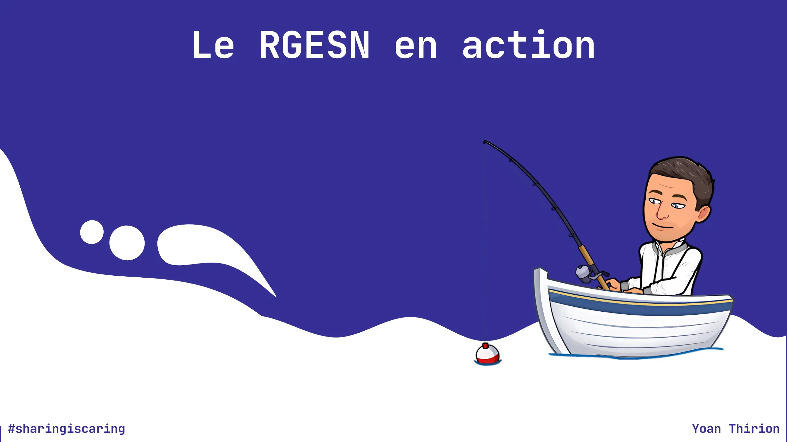
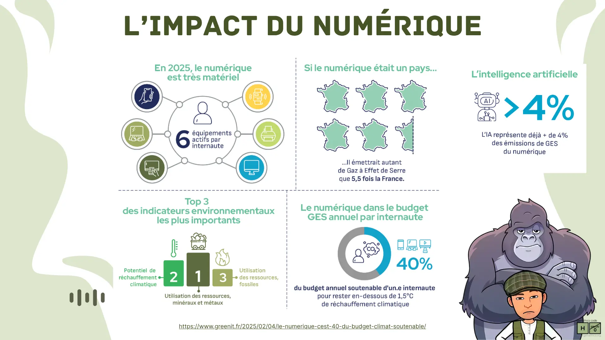
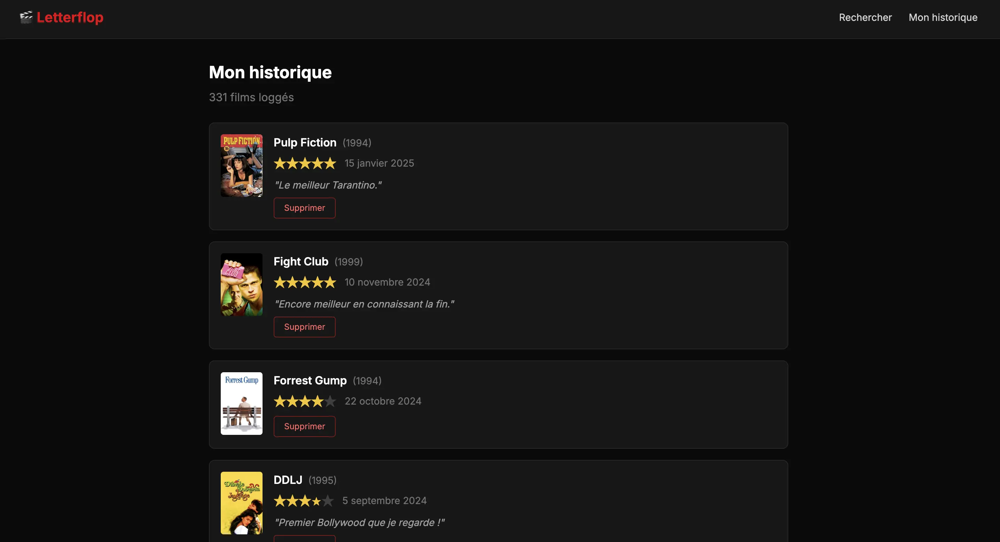
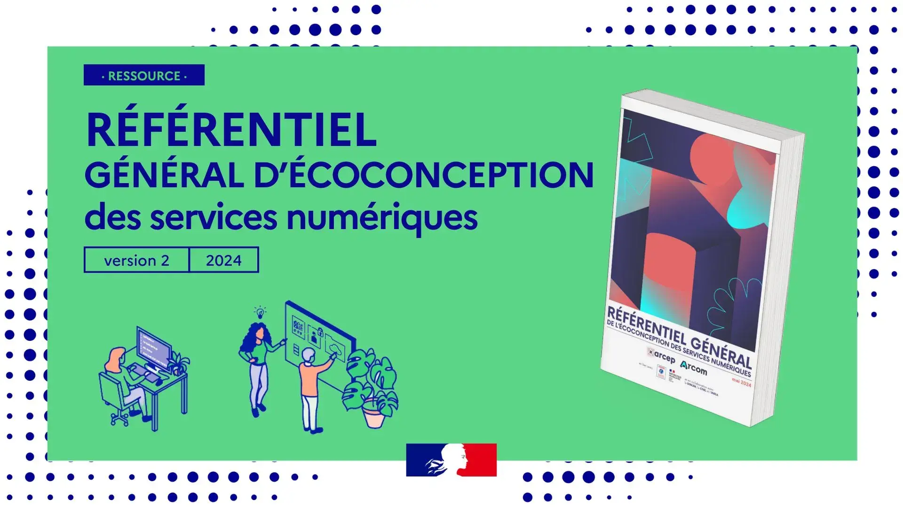

# Atelier RGESN - Le numérique responsable en action



On parle beaucoup de numérique responsable, de fresque du numérique, de manifeste, de chartes signées en conférence. Mais lundi matin, devant ton IDE, qu'est-ce qui change vraiment ?

**Cet atelier n'est pas une énième prise de conscience. C'est une boîte à outils.**

15 exercices pratiques que tu pourras appliquer immédiatement - sur ton produit, dans tes affinages, dans ton code. 

> Le but : que tu repartes capable de te questionner et d'utiliser ces outils **dès demain**.

---

## L'impact du numérique en quelques chiffres

Quelques repères pour poser le contexte avant de commencer :



- **6** équipements numériques actifs par personne en moyenne
- Si le numérique était un pays, il émettrait autant de gaz à effet de serre que **5,5 fois la France**
- L'intelligence artificielle représente déjà **plus de 4 %** des émissions de GES du numérique
- Le numérique représente **40 %** du budget GES annuel soutenable d'un·e internaute pour rester sous les 1,5 °C de réchauffement climatique

Et parmi les indicateurs environnementaux, ce n'est pas le carbone le plus critique : l'**utilisation des ressources, minéraux et métaux** arrive en tête, devant le réchauffement climatique et l'épuisement des ressources fossiles.

> Ces chiffres ne se règlent pas en signant une charte. Ils se règlent dans le code, l'architecture et les choix produit - ce que cet atelier te donne les moyens de faire.

**Source :** [GreenIT.fr - Le numérique, c'est 40 % du budget climat soutenable (2025)](https://www.greenit.fr/2025/02/04/le-numerique-cest-40-du-budget-climat-soutenable/)

---

## Letterflop - Le fil rouge



**Letterflop** est un journal de visionnage de films. L'application permet de rechercher des films (via l'API `TMDB`), consulter leurs fiches, enregistrer des visionnages avec une note, et parcourir son historique.

Code source : [github.com/ythirion/letter-flop](https://github.com/ythirion/letter-flop)

**Stack technique :** 
- PostgreSQL 15
- Spring Boot 3.5 / Java 25
- TypeScript / Tailwind / Vite
- Docker Compose

**La particularité** : la codebase contient volontairement des **mauvaises pratiques** documentées couvrant l'ensemble des familles du RGESN. 
Chaque exercice vous guide pour les identifier, les mesurer et les corriger.

**Deux branches :**
- `main` - le code de départ, avec les mauvaises pratiques à identifier et corriger pendant l'atelier
- `rgesn` - le corrigé de référence, pour comparer votre solution ou débloquer un exercice

---

## Prérequis

- `Docker` et `Docker Compose`
- Un `IDE` (VS Code, IntelliJ...)
- `Node.js` 20+
- Un navigateur avec les `DevTools`
- Une clé API TMDB (gratuite sur [themoviedb.org](https://www.themoviedb.org))

## Installation

```bash
git clone https://github.com/ythirion/letter-flop
cd letter-flop

cp .env.example .env
# Éditer .env et ajouter votre TMDB_API_KEY

docker compose up --build
```

L'application est accessible sur `http://localhost:3000`.

> Besoin de comparer avec le corrigé ? `git checkout rgesn` (dans une copie séparée du repo, pour ne pas écraser votre travail).

---

## Extensions navigateur

Installez ces extensions **avant** de commencer l'atelier - vous les utiliserez tout au long des exercices :

| Extension            | Description                                                                                | Lien                                                                                                               |
|----------------------|--------------------------------------------------------------------------------------------|--------------------------------------------------------------------------------------------------------------------|
| **GreenIT Analysis** | Analyse l'empreinte environnementale d'une page (EcoIndex, nombre de requêtes, poids, DOM) | [Chrome Web Store](https://chromewebstore.google.com/detail/greenit-analysis/mofbfhffeklkbebfclfaiifefjflcpad)     |
| **GreenTrackR**      | Suivi continu de l'empreinte carbone de votre navigation                                   | [Chrome Web Store](https://chromewebstore.google.com/detail/greentrackr/felcpalgepcmkphplglfpmgbidfmanea)          |
| **Lighthouse**       | Audit performance, accessibilité, bonnes pratiques (intégré à Chrome DevTools)             | Intégré                                                                                                            |
| **WAVE**             | Évaluation de l'accessibilité web                                                          | [Chrome Web Store](https://chromewebstore.google.com/detail/wave-evaluation-tool/jbbplnpkjmmeebjpijfedlgcdilocofh) |

---

## Le RGESN

[](https://ecoresponsable.numerique.gouv.fr/publications/referentiel-general-ecoconception/)

Le **Référentiel Général d'Écoconception des Services Numériques** (RGESN) est publié par l'ARCEP, l'Arcom, l'ADEME et la DINUM. 

Il comprend **79 critères** répartis en **9 familles** :

1. Stratégie
2. Spécifications
3. Architecture
4. UX/UI
5. Contenus
6. Frontend
7. Backend
8. Hébergement
9. Algorithmie

Cet atelier couvre les 9 familles à travers des exercices concrets sur Letterflop.

---

## Format

- **Durée** : 1 journée (~7-8h) ou 2 demi-journées
- **Mode** : mob programming (3-4 personnes) ou pair programming
- **Niveau** : développeur·se·s front / back / fullstack, aucun prérequis en numérique responsable

**Avec quoi tu repars ?** Une liste de pratiques concrètes, des outils installés, et une règle simple : en choisir 2, les appliquer cette semaine. 

> Parce que des logiciels bien conçus *et* sobres, ça ne se décrète pas - ça se pratique.

---

## Les exercices

### Phase 1 - Comprendre et mesurer

| #  | Exercice                                                                                                            | Durée  | Thème                                                           |
|----|---------------------------------------------------------------------------------------------------------------------|--------|-----------------------------------------------------------------|
| 01 | [Mesurer avant d'agir](exercices/exercice%2001%20-%20mesurer%20avant%20d%20agir/enonce.md)                          | 20 min | Baseline complète de Letterflop (Docker, réseau, API, EcoIndex) |
| 02 | [Le pari empreinte et l'ACV express](exercices/exercice%2002%20-%20pari%20empreinte%20et%20acv%20express/enonce.md) | 25 min | Estimer l'impact CO2e, mini-ACV, comparer des features          |

### Phase 2 - Challenger le besoin

| #  | Exercice                                                                                 | Durée  | Thème                                                        |
|----|------------------------------------------------------------------------------------------|--------|--------------------------------------------------------------|
| 03 | [Challenger le besoin](exercices/exercice%2003%20-%20challenger%20le%20besoin/enonce.md) | 20 min | Grille de décision RGESN, arbitrage produit, audit stratégie |

### Phase 3 - Infrastructure

| # | Exercice | Durée | Thème |
|---|----------|-------|-------|
| 04 | [Multi-stage builds Docker](exercices/exercice%2004%20-%20multi-stage%20builds%20docker/enonce.md) | 40 min | Réécrire les Dockerfiles (2.63 GB → 791 MB) |
| 05 | [Hébergement responsable](exercices/exercice%2005%20-%20hebergement%20responsable/enonce.md) | 30 min | PUE, WUE, choix d'hébergeur, architecture hot/cold |

### Phase 4 - Frontend

| #  | Exercice                                                                                                           | Durée  | Thème                                                       |
|----|--------------------------------------------------------------------------------------------------------------------|--------|-------------------------------------------------------------|
| 06 | [Polices système et composants natifs](exercices/exercice%2006%20-%20polices%20et%20composants%20natifs/enonce.md) | 35 min | Supprimer Google Fonts, radio buttons natifs, focus visible |
| 07 | [Images adaptées et lazy loading](exercices/exercice%2007%20-%20images%20adaptees%20et%20lazy%20loading/enonce.md) | 30 min | Tailles TMDB, loading="lazy", alt text (4.5 MB → 274 KB)    |
| 08 | [Pagination serveur](exercices/exercice%2008%20-%20pagination%20serveur/enonce.md)                                 | 25 min | Remplacer la pagination client (1000 logs → 6)              |

### Phase 5 - Backend

| # | Exercice | Durée | Thème |
|---|----------|-------|-------|
| 09 | [SQL, pagination et indexes](exercices/exercice%2009%20-%20sql%20pagination%20et%20indexes/enonce.md) | 40 min | Pageable Spring Data, COUNT, indexes B-tree (+77% req/s) |
| 10 | [Cache applicatif et N+1](exercices/exercice%2010%20-%20cache%20applicatif%20et%20n%2B1/enonce.md) | 40 min | @Cacheable Caffeine, timeouts RestTemplate |
| 11 | [Stockage sobre et rétention](exercices/exercice%2011%20-%20stockage%20sobre%20et%20retention/enonce.md) | 35 min | Chemin TMDB canonique, migration SQL, politique de rétention |

### Phase 6 - Aller plus loin

| # | Exercice | Durée | Thème |
|---|----------|-------|-------|
| 12 | [Usage de l'IA](exercices/exercice%2012%20-%20usage%20de%20l%20ia/enonce.md) | 20 min | Arbre de décision IA vs déterministe, estimation d'impact |
| 13 | [EcoIndex dans la CI](exercices/exercice%2013%20-%20ecoindex%20dans%20la%20ci/enonce.md) | 30 min | GitHub Action GreenIT Analysis, quality gate |
| 14 | [Badge de transparence](exercices/exercice%2014%20-%20badge%20de%20transparence/enonce.md) | 25 min | Badge EcoIndex officiel, page "Notre empreinte" |

### Phase 7 - Bilan

| # | Exercice | Durée | Thème |
|---|----------|-------|-------|
| 15 | [Le boss final - Bilan global](exercices/exercice%2015%20-%20boss%20final%20bilan%20global/final.md) | 30 min | Mesure finale, rapport d'écoconception, engagement |

---

## Couverture RGESN

| Famille RGESN | Exercice(s) |
|---------------|-------------|
| 1. Stratégie | 01, 03, 13, 14 |
| 2. Spécifications | 02, 03, 11, 12 |
| 3. Architecture | 04 |
| 4. UX/UI | 06 |
| 5. Contenus | 07 |
| 6. Frontend | 07, 08 |
| 7. Backend | 09, 10, 11 |
| 8. Hébergement | 05 |

---

## Validation

Chaque exercice utilise des outils de mesure concrets - pas de "faites-moi confiance", du chiffre :

| Outil                                                                          | Usage                                  |
|--------------------------------------------------------------------------------|----------------------------------------|
| `docker images`                                                                | Taille des images de conteneurs        |
| DevTools Network                                                               | Requêtes, transfert, domaines externes |
| GreenIT Analysis (extension)                                                   | Score EcoIndex, complexité DOM, poids  |
| `./scripts/benchmark.sh`                                                       | Débit API sous charge (Apache Bench)   |
| `EXPLAIN ANALYZE`                                                              | Plans d'exécution SQL                  |
| Logs serveur                                                                   | Appels API TMDB                        |
| [greenit-analysis-action](https://github.com/ythirion/greenit-analysis-action) | Quality gate EcoIndex dans la CI       |
| [ecoindex_badge](https://github.com/cnumr/ecoindex_badge)                      | Badge de transparence sur le site      |

---

## Green Craft - Le manifeste

Cet atelier s'inscrit dans la continuité de [**Green Craft**](https://green-craft.fr), l'alliance du Software Craftsmanship et du Numérique Responsable : des artisan·e·s du logiciel qui placent l'excellence technique au service de la sobriété, de l'accessibilité et de l'impact positif sur la société.

> ### Manifeste pour l'artisanat logiciel responsable
>
> En tant qu'aspirant·e·s Artisan·e·s du Logiciel, nous relevons le niveau du développement professionnel de logiciels par la pratique et en aidant les autres à acquérir le savoir-faire. Grâce à ce travail, nous avons appris à apprécier :
>
> Des logiciels bien conçus
> ET aussi **sobres et durables**.
>
> Pas seulement ajouter constamment de la valeur,
> mais aussi **de la valeur respectueuse des ressources**.
>
> Plus qu'une communauté de professionnels,
> une communauté dédiée à **un numérique soutenable**.
>
> Des partenariats productifs permettant de co-construire
> des solutions **conscientes de leur impact environnemental et sociétal**.

→ Retrouvez le manifeste complet et les 4 valeurs détaillées sur [green-craft.fr](https://green-craft.fr).

---

## Ressources

- [RGESN officiel (ARCEP/Arcom/ADEME/DINUM)](https://ecoresponsable.numerique.gouv.fr/publications/referentiel-general-ecoconception/)
- [EcoIndex](https://www.ecoindex.fr/)
- [GR491 - Guide de Référence de conception responsable](https://gr491.isit-europe.org/)
- [GreenIT.fr](https://www.greenit.fr/)
- [Electricity Maps - intensité carbone en temps réel](https://www.electricitymaps.com)
- [Green Web Foundation](https://www.thegreenwebfoundation.org)
- [Cloud Carbon Footprint](https://www.cloudcarbonfootprint.org)


## TODO
- Mesurer : ajouter eco-index results + screen shots