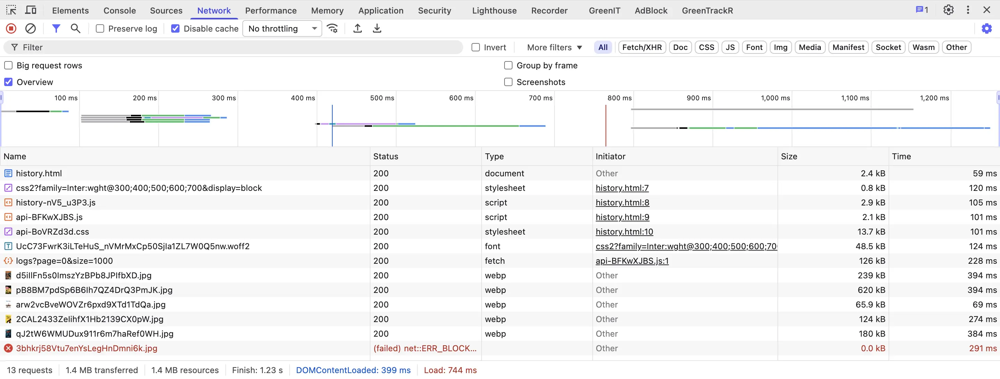

# Exercice 6 : Polices système et composants natifs

## Critères RGESN

- **4.5** - Le service utilise-t-il des composants d'interface natifs plutôt que personnalisés ?
- **4.8** - Le service limite-t-il le téléchargement de polices ?
- **6.7** - Les ressources sont-elles hébergées sur le même domaine ?

## Contexte



Avant même de taper un caractère dans la barre de recherche, Letterflop fait des requêtes vers Google pour télécharger une police web. Chaque visite paie ce coût : DNS, TCP, TLS, téléchargement de la police, parsing, application. Et tout ça pour afficher du texte que la police système du navigateur sait déjà rendre.

De plus, le widget de notation par étoiles sur la page film utilise des `<span>` avec des événements `mouseenter`/`mouseleave`/`click` - inaccessible au clavier et inutilement complexe.

## Votre mission

### 1. Supprimer Google Fonts (~10 min)

Dans les 3 fichiers HTML (`index.html`, `movie.html`, `history.html`) :
- Trouvez et supprimez le(s) `<link>` qui chargent Google Fonts
- Remplacez la police dans le style par `system-ui`

```html
<!-- AVANT (à supprimer) -->
<link href="https://fonts.googleapis.com/css2?family=Inter:wght@400;600;700&display=block" rel="stylesheet">

<!-- AVANT (dans le style) -->
font-family: 'Inter', sans-serif;

<!-- APRÈS -->
font-family: system-ui, -apple-system, sans-serif;
```

### 2. Remplacer le star rating par des radio buttons natifs (~20 min)

Dans `frontend/src/pages/movie.ts`, remplacez le widget de notation custom par des `<input type="radio">` natifs :

```html
<!-- Objectif : un fieldset avec 5 radio buttons, accessible au clavier -->
<fieldset>
  <legend class="sr-only">Votre note</legend>
  <!-- 5 radio buttons avec aria-label -->
</fieldset>
```

Caractéristiques de la version corrigée :
- Navigation au clavier (Tab + flèches)
- `aria-label` sur chaque radio
- Pas de JavaScript pour la sélection
- Affichage visuel des étoiles via CSS

### 3. Corriger le focus visible (~5 min)

Dans `index.html`, trouvez `focus:outline-none` sur le champ de recherche et remplacez-le par un focus visible.

Ajoutez un `aria-label` au champ de recherche.

## Avant de coder

1. Ouvrez les DevTools → onglet **Network**
2. Rechargez la page de recherche
3. Filtrez par "Fonts" ou par domaine `fonts.googleapis.com`
4. Notez le nombre de requêtes et les domaines externes

## Validation

Après correction :
- DevTools Network → filtrer par `fonts.googleapis.com` → **0 requêtes**
- Le texte s'affiche instantanément (plus de flash de texte invisible)
- Le rating fonctionne au clavier (Tab pour atteindre, flèches pour naviguer)
- Le champ de recherche a un indicateur de focus visible

## Indice

- Fichiers HTML : `frontend/index.html`, `frontend/movie.html`, `frontend/history.html`
- Widget étoiles : `frontend/src/pages/movie.ts`, cherchez la partie qui gère le rating
- `system-ui` fait que chaque OS affiche sa police native : San Francisco (macOS), Segoe UI (Windows), Roboto (Android)

---

→ [Proposition de solution](reponse.md)
