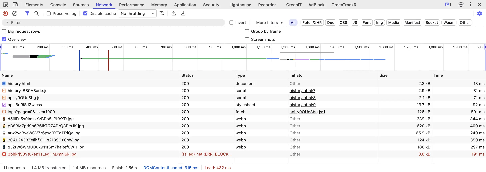

# Exercice 6 — Réponse

## 1. Suppression de Google Fonts

Dans chaque fichier HTML (`index.html`, `movie.html`, `history.html`) :

**Supprimer :**
```html
<link href="https://fonts.googleapis.com/css2?family=Inter:wght@400;600;700&display=block" rel="stylesheet">
```

**Remplacer dans le `<body>` :**
```html
<!-- AVANT -->
<body style="font-family: 'Inter', sans-serif;">

<!-- APRÈS -->
<body style="font-family: system-ui, -apple-system, sans-serif;">
```

## 2. Star rating avec radio buttons natifs

Dans `movie.ts`, remplacer le widget custom par :

```html
<fieldset class="flex items-center gap-1">
  <legend class="sr-only">Votre note</legend>
  ${[1, 2, 3, 4, 5].map(value => `
    <label class="cursor-pointer">
      <input type="radio" name="rating" value="${value}"
             class="sr-only peer"
             aria-label="${value} étoile${value > 1 ? 's' : ''}"
             ${value === 3 ? 'checked' : ''}>
      <span class="text-2xl peer-checked:text-yellow-400 text-neutral-600
                   hover:text-yellow-300 transition-colors">★</span>
    </label>
  `).join('')}
</fieldset>
```

En TypeScript, récupérer la valeur :
```typescript
const rating = document.querySelector<HTMLInputElement>('input[name="rating"]:checked')?.value;
```

**Avantages :**
- Navigation clavier native (Tab + flèches directionnelles)
- Accessible aux lecteurs d'écran via `aria-label`
- Zéro JavaScript pour la sélection
- État visuel géré par CSS (`peer-checked`)

## 3. Focus visible et aria-label

Dans `index.html`, remplacer :
```html
<!-- AVANT -->
<input class="... focus:outline-none" />

<!-- APRÈS -->
<input
  class="... focus:outline focus:outline-2 focus:outline-red-500"
  aria-label="Rechercher un film par titre"
/>
```

## Résultats mesurés



| Métrique                | Avant       | Après    | Gain     |
|-------------------------|-------------|----------|----------|
| Requêtes vers Google    | 2-4         | 0        | −100 %   |
| Domaines externes       | 2 (fonts.googleapis.com + fonts.gstatic.com) | 0 | −100 % |
| Temps premier rendu texte | 200-500ms de blocage | Instantané | −100% blocage |
| Rating accessible clavier | Non       | Oui      | Conformité WCAG |

## Ce que la mesure vérifie

```
DevTools → Network → filtre "fonts.googleapis.com" → 0 résultats
```

## Pourquoi c'est important

**Google Fonts :**
- Chaque visite télécharge la police (~100 KB, 2-4 requêtes, 2 domaines externes)
- `display=block` bloque le rendu de tout le texte jusqu'au chargement
- La police est un choix esthétique, pas fonctionnel — `system-ui` est déjà optimisé pour chaque OS

**Composants natifs :**
- Un `<input type="radio">` est nativement accessible au clavier, aux lecteurs d'écran, et aux technologies d'assistance
- Un widget custom en JavaScript nécessite des événements, du state management, et des attributs ARIA manuels — pour un résultat fonctionnellement identique
- Le RGESN 4.5 recommande explicitement les composants natifs quand ils existent

**Focus visible :**
- `focus:outline-none` est l'une des violations d'accessibilité les plus courantes
- Un utilisateur au clavier ne peut pas savoir où il se trouve sur la page — violation WCAG 2.4.7
- L'accessibilité fait partie du numérique responsable (volet sociétal)

## Bonnes pratiques

- **`system-ui` par défaut** — n'ajouter une police web que si la charte graphique l'exige absolument
- **Composant natif d'abord** — n'écrire un widget custom que si aucun élément HTML natif ne fait le travail
- **Jamais `focus:outline-none` seul** — toujours fournir un indicateur de focus alternatif
- **`aria-label`** sur tout élément interactif sans texte visible

## Boîte à outils

| Outil | Usage |
|-------|-------|
| DevTools Network (filtre domaine) | Vérifier les requêtes vers domaines externes |
| Tab key | Tester la navigation clavier |
| Lecteur d'écran (VoiceOver / NVDA) | Vérifier les labels et annonces |
| Lighthouse → Accessibility | Score d'accessibilité automatisé |
