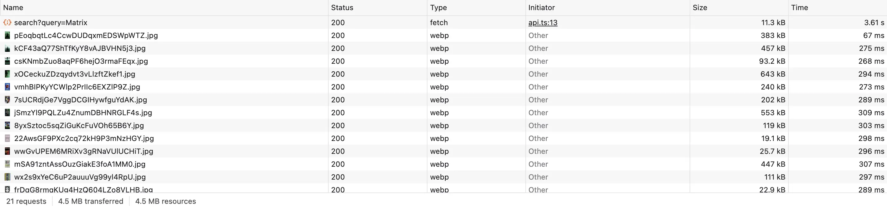

# Exercice 7 : Images adaptées et lazy loading

## Critères RGESN

- **6.4** - Les médias sont-ils adaptés au contexte d'affichage ?
- **6.5** - Le service charge-t-il uniquement les ressources strictement nécessaires ?

## Contexte

Une recherche "Matrix" charge 20 affiches en taille `original` - jusqu'à 500 KB par image, soit **~4.5 MB** pour des vignettes affichées en 200 px. TMDB propose pourtant des tailles adaptées : `w185`, `w342`, `w500`.



De plus, les 20 images se téléchargent simultanément au chargement, même celles hors écran. Et aucune n'a d'attribut `alt` significatif ni de dimensions explicites.

## Votre mission

### 1. Adapter la taille des images TMDB (~10 min)

Dans `backend/src/main/java/com/yot/letterflop/service/TmdbService.java` :
- Les résultats de recherche (`searchMovies`) → taille `w185` (vignettes de liste)
- La fiche film (`getMovieDetail`) → taille `w342` (affichage plus grand)

Cherchez les lignes qui construisent l'URL de l'image avec `original` et remplacez par la bonne taille.

### 2. Ajouter le lazy loading (~10 min)

Dans les 3 fichiers TypeScript du frontend :
- `frontend/src/pages/search.ts`
- `frontend/src/pages/movie.ts`
- `frontend/src/pages/history.ts`

Ajoutez `loading="lazy"` à chaque balise `` dans les template literals.

### 3. Ajouter les dimensions (~5 min)

Ajoutez `width` et `height` sur les images pour éviter le Layout Shift (CLS) :
- Vignettes de recherche : `width="185" height="278"` (ratio 2:3)
- Vignettes d'historique : `width="60" height="90"`
- Affiche de la fiche film : `width="342" height="513"`

### 4. Ajouter des textes alternatifs (~5 min)

Remplacez `alt=""` par un texte descriptif :
```html
alt="Affiche du film ${movie.title}"
```

## Avant de coder

1. Ouvrez DevTools → onglet **Network**
2. Filtrez par "Img" (images uniquement)
3. Recherchez "Matrix"
4. Notez : nombre d'images chargées, taille totale transférée, domaine source

## Validation

Après correction, recherchez "Matrix" et observez dans DevTools Network (filtre images) :
- La taille totale des images doit être **< 500 KB** (au lieu de ~4.5 MB)
- Les URLs d'images doivent contenir `/w185/` et non `/original/`
- Le nombre d'images chargées immédiatement doit être réduit (lazy loading)

## Indice

- Dans `TmdbService.java`, cherchez `"https://image.tmdb.org/t/p/"` - c'est là que la taille est spécifiée
- Tailles TMDB disponibles : `w92`, `w154`, `w185`, `w342`, `w500`, `w780`, `original`
- `loading="lazy"` est un attribut HTML standard - pas de JavaScript requis
