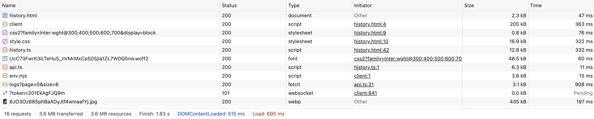

# Exercice 8 : Pagination serveur

## Critères RGESN

- **6.5** — Le service charge-t-il uniquement les ressources strictement nécessaires ?
- **7.1** — Le service optimise-t-il les requêtes et traitements côté serveur ?

## Contexte

La page Historique demande **1000 logs** au serveur pour en afficher **6**. À chaque changement de page (Précédent / Suivant), elle redemande les 1000 logs, les filtre côté client, et jette les 994 inutiles.



Le backend supporte déjà la pagination via Spring Data (`Pageable`) — le frontend ne l'utilise simplement pas.

## Votre mission

### 1. Identifier le problème (~5 min)

Ouvrez `frontend/src/pages/history.ts` et identifiez :
- Quel appel API est fait au chargement ?
- Quelle valeur a le paramètre `size` ?
- Comment la pagination est-elle gérée ?

### 2. Corriger la pagination (~15 min)

Modifiez `history.ts` pour utiliser la pagination serveur :

**AVANT** (ce que vous devriez trouver dans la branche violations) :
```typescript
// Charge TOUT à chaque changement de page
async function loadPage(page: number): Promise<void> {
  const data = await getLogs(0, 1000);  // 1000 logs !
  const allLogs = data.content;
  totalLogs = allLogs.length;

  const start = page * PAGE_SIZE;
  const slice = allLogs.slice(start, start + PAGE_SIZE);  // Pagination client
  // ...
}
```

**APRÈS** :
```typescript
async function loadPage(page: number): Promise<void> {
  const data = await getLogs(page, PAGE_SIZE);  // Seulement PAGE_SIZE logs
  const slice = data.content;                    // Pas de slice côté client
  totalLogs = data.totalElements;                // Le serveur connaît le total
  // ...
}
```

### 3. Vérifier la réponse du serveur

L'API `/api/logs` accepte les paramètres `page` et `size` et retourne :
```json
{
  "content": [...],        // Les logs de la page demandée
  "totalElements": 330,    // Nombre total de logs
  "totalPages": 55,        // Nombre total de pages
  "currentPage": 0         // Page courante
}
```

## Avant de coder

1. Ouvrez DevTools → onglet **Network** → filtre **XHR**
2. Naviguez vers la page Historique
3. Observez la requête vers `/api/logs` :
   - Quel est le paramètre `size` dans l'URL ?
   - Quelle est la taille de la réponse (octets) ?
4. Cliquez sur "Suivant" et observez la nouvelle requête

## Validation

Après correction, dans DevTools Network (filtre XHR) :
- La requête doit être `/api/logs?page=0&size=6`
- La réponse doit contenir exactement 6 items dans `content`
- Cliquer sur "Suivant" doit charger `/api/logs?page=1&size=6` (pas recharger page 0)

## Indice

- `PAGE_SIZE` est déjà défini à `6` dans `history.ts`
- L'API `getLogs(page, size)` dans `api.ts` passe déjà les paramètres au serveur
- Le serveur retourne un objet avec `content`, `totalElements`, `totalPages`, `currentPage`
- Il n'y a qu'un seul fichier à modifier : `frontend/src/pages/history.ts`
