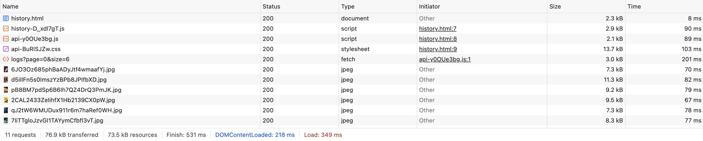

# Exercice 8 - Réponse

## Solution - history.ts

La correction tient en 3 lignes modifiées :

```typescript
const PAGE_SIZE = 6;
let currentPage = 0;
let totalLogs = 0;

async function loadPage(page: number): Promise<void> {
  const data = await getLogs(page, PAGE_SIZE);   // ← page et PAGE_SIZE au lieu de (0, 1000)
  const slice = data.content;                     // ← directement, sans .slice()

  totalLogs = data.totalElements;                 // ← le serveur connaît le total

  if (totalLogs === 0) {
    loadingEl.classList.add('hidden');
    emptyEl.classList.remove('hidden');
    return;
  }

  const totalPages = data.totalPages;             // ← du serveur, pas calculé côté client

  updateTotal();
  renderSlice(slice);

  if (totalPages > 1) {
    pagination.classList.remove('hidden');
    pageInfo.textContent = `Page ${page + 1} / ${totalPages}`;
    prevBtn.disabled = page === 0;
    nextBtn.disabled = page === totalPages - 1;
  } else {
    pagination.classList.add('hidden');
  }

  loadingEl.classList.add('hidden');
  contentEl.classList.remove('hidden');
}
```



**Ce qui a changé :**
1. `getLogs(0, 1000)` → `getLogs(page, PAGE_SIZE)` - ne charge que la page demandée
2. Plus de `allLogs.slice(start, start + PAGE_SIZE)` - le serveur pagine
3. `totalLogs = allLogs.length` → `totalLogs = data.totalElements` - le serveur connaît le total
4. `totalPages` vient de `data.totalPages` au lieu d'être calculé

## Résultats mesurés

| Métrique | Avant | Après | Gain |
|----------|-------|-------|------|
| Logs transférés par requête | 1000 | 6 | **−99.4 %** |
| Taille de la réponse | ~123 KB | ~3 KB | **−97 %** |
| Requêtes par changement de page | 1 (même requête) | 1 (page suivante) | Identique |
| Full table scans côté serveur | 3 | 1 (paginé) | **−67 %** |

## Ce que la mesure vérifie

```
DevTools → Network → XHR → cliquer sur la requête /api/logs
```
- L'URL doit contenir `?page=0&size=6`
- L'onglet "Response" doit montrer 6 items dans `content`
- `totalElements` doit indiquer le nombre total de logs en base

## Pourquoi c'est important

**Triple inefficacité de la pagination client :**

```
Navigateur                    Serveur                      Base de données
    │                            │                              │
    │── GET /api/logs?size=1000 ─►│                              │
    │                            │── SELECT * FROM movie_logs ──►│
    │                            │◄─── 1000 lignes + synopsis ───│
    │◄── 1000 logs (123 KB) ─────│                              │
    │                            │                              │
    │  slice(0, 6)               │                              │
    │  affiche 6 logs            │                              │
    │  jette 994 logs            │                              │
```

1. **Réseau** : 123 KB transférés pour 3 KB utiles
2. **Serveur** : charge 1000 entités en mémoire Java (avec synopsis TEXT)
3. **Base** : full table scan sans pagination SQL (pas de LIMIT/OFFSET)

La pagination serveur résout les 3 problèmes en une seule correction frontend.

## Bonnes pratiques

- **Paginer côté serveur par défaut** - la pagination client n'est justifiée que pour de très petits jeux de données (<50 items)
- **Le frontend ne doit jamais décider de la taille totale** - c'est le serveur qui connaît le `COUNT`
- **Taille de page adaptée** - 6 items pour un historique, 20 pour un listing admin, 50 max pour une API
- **Ce correctif connecte au backend** - l'exercice 9 corrigera le service `getAllLogs()` côté serveur qui avait aussi des problèmes de pagination

## Boîte à outils

| Outil | Usage |
|-------|-------|
| DevTools Network → XHR | Observer les requêtes API et leurs réponses |
| DevTools → onglet Response | Voir le contenu JSON de la réponse |
| `curl http://localhost:8080/api/logs?page=0&size=6` | Tester l'API directement |
